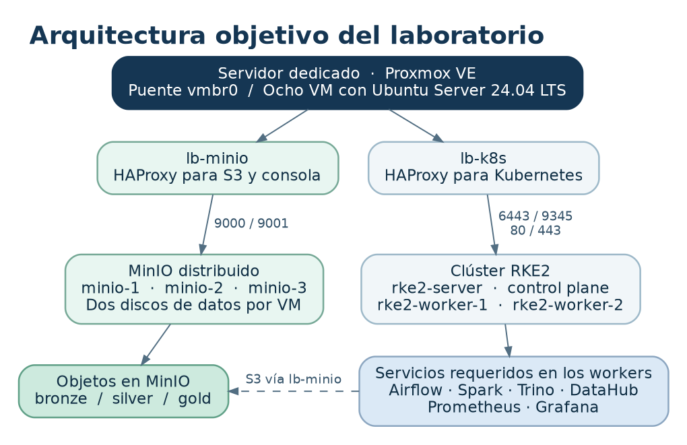
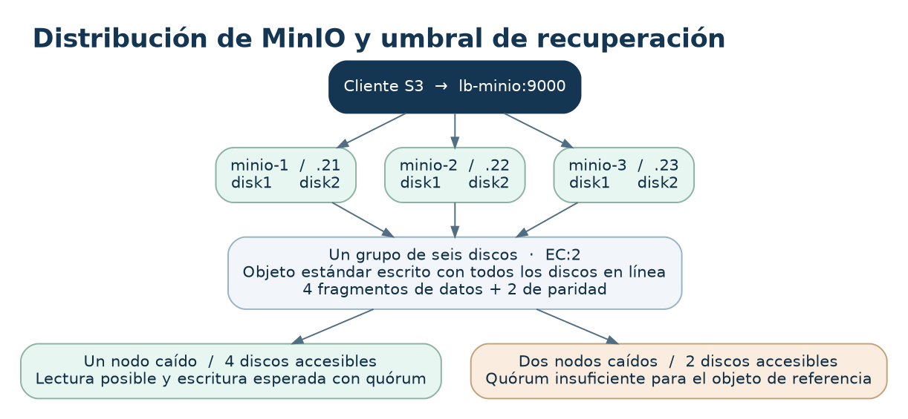
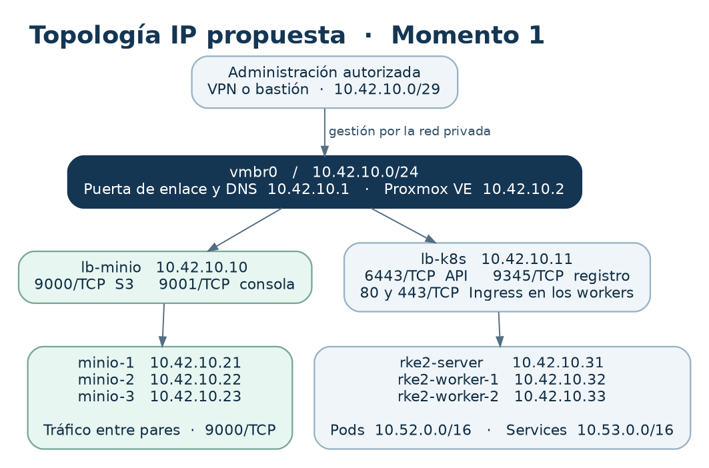
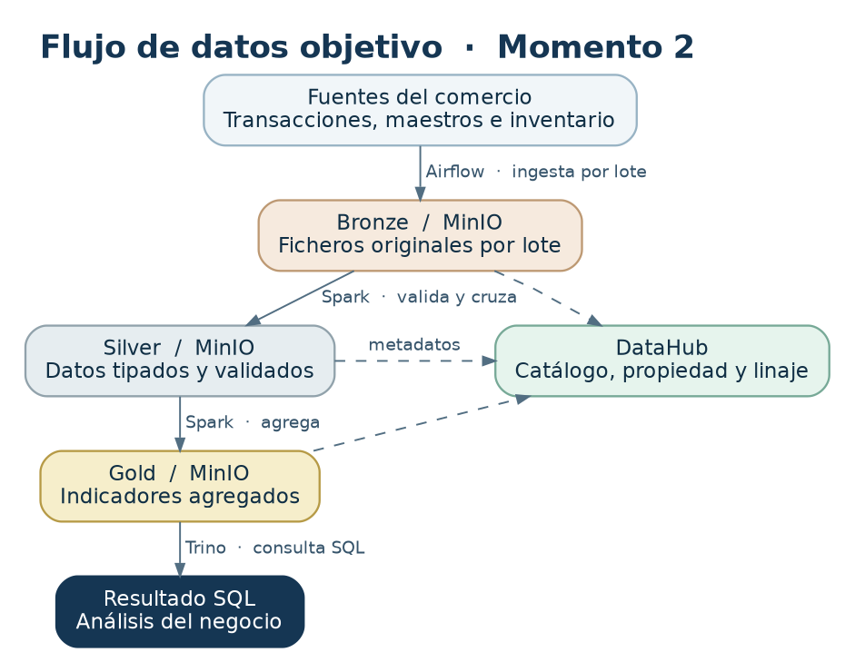

# Documento de arquitectura

## Plataforma objetivo

Una empresa minorista necesita reconciliar ventas e inventario de sus sucursales. El almacenamiento de objetos conserva los lotes originales para que una corrección del catálogo de productos pueda procesarse de nuevo. Kubernetes aporta un entorno común para los servicios que ingieren, transforman y consultan esos lotes. El profesor sitúa ambos clústeres en máquinas virtuales de un mismo servidor, con accesos diferenciados para almacenamiento y cómputo. La figura 1 traduce ese diseño al inventario del proyecto. [Requisitos originales, pp. 1–4](../../Lago%20de%20Datos%20Distribuido.pdf)

El hipervisor aloja tres servidores MinIO, dos balanceadores y tres nodos RKE2. Las VM de balanceo terminan o reenvían conexiones según el protocolo. Las capas Bronze, Silver y Gold son buckets compartidos por todo el clúster MinIO. En Kubernetes, Airflow programa la ingesta, Spark transforma los datos, Trino ejecuta las consultas, DataHub cataloga los activos, Prometheus recoge métricas y Grafana las visualiza. La colocación inicial sugerida en el PDF sitúa Airflow y Spark en el primer worker y los otros cuatro componentes en el segundo. El scheduler puede reasignar cargas según recursos, volúmenes y afinidades.

## Capacidad y dominios de fallo

| Función | VM | vCPU por VM | RAM por VM | Discos por VM |
|---|---:|---:|---:|---|
| Balanceo de objetos y Kubernetes | 2 | 1 | 1 GiB | SO de 16 GiB |
| MinIO | 3 | 2 | 4 GiB | SO de 20 GiB y dos unidades de datos de 20 GiB |
| Servidor RKE2 | 1 | 4 | 8 GiB | SO de 40 GiB |
| Worker de procesamiento | 1 | 6 | 12 GiB | SO de 64 GiB |
| Worker de analítica | 1 | 8 | 16 GiB | SO de 64 GiB |

La asignación inicial suma 26 vCPU virtuales, 50 GiB de RAM y 380 GiB de discos virtuales, antes de reservar capacidad para el hipervisor, imágenes y copias. Las vCPU constituyen asignaciones del inventario. La capacidad física necesaria depende de la concurrencia e I/O. Los seis discos de datos suman 120 GiB brutos. Para objetos grandes con el grupo íntegro y paridad EC:2, los fragmentos de datos ocupan cuatro sextas partes del total, aproximadamente 80 GiB teóricos antes de reservas, metadatos y sobrecarga. [Inventario de VM](../../infrastructure/proxmox/inventory.json)

La pérdida de una VM MinIO elimina simultáneamente dos unidades del conjunto. Un objeto escrito con EC:2 y seis discos en línea ocupa cuatro fragmentos de datos y dos de paridad. El modelo prevé lectura y escritura con los cuatro discos restantes si la red y el balanceador siguen operativos. Una segunda pérdida de nodo excede el límite del ejemplo. Las pruebas P3 y P4 registran la disponibilidad efectiva y la integridad en la topología de ensayo. Un error del host Proxmox, un corte eléctrico común o la pérdida del almacenamiento subyacente afecta varias VM a la vez. Se necesita una copia independiente para recuperar el conjunto tras esa clase de incidente. [Codificación de borrado en MinIO Community](https://github.com/minio/minio/blob/RELEASE.2025-04-22T22-12-26Z/docs/erasure/README.md)

Kubernetes conserva su estado en etcd en el único servidor RKE2 del diseño. Los dos workers ofrecen destinos de ejecución alternativos cuando hay recursos y almacenamiento accesible. Perder el servidor impide nuevos cambios de planificación. La continuidad de un pod depende de sus réplicas, volúmenes y capacidad restante. Cada balanceador y el host Proxmox también son puntos únicos de fallo. [Alta disponibilidad en RKE2](https://docs.rke2.io/install/ha)

## Red y acceso

El direccionamiento propuesto se reproduce desde el inventario. Las ocho VM comparten el bridge vmbr0 y resuelven los nombres del laboratorio. El gateway y DNS previstos son 10.42.10.1 y el host de gestión es 10.42.10.2. El acceso administrativo parte del segmento de gestión 10.42.10.0/29 a través del bastión o la VPN que proporcione el operador. El origen debe ser alcanzable antes de activar reglas restrictivas. La red de pods 10.52.0.0/16 y la de servicios 10.53.0.0/16 se distinguen del segmento 10.42.10.0/24 de las VM. [Matriz de comunicaciones](../../architecture/network/communication.csv)

El cliente S3 contacta con lb-minio en el puerto 9000. El navegador administrativo usa el puerto 9001. Los nodos MinIO intercambian datos internamente y HAProxy consulta su disponibilidad. En Kubernetes, lb-k8s reenvía 6443 y 9345 al servidor. Los puertos 80 y 443 se encaminan hacia el Ingress de los workers. El portal de consulta entrega copias de resultados al profesor. Las rutas privadas de administración se reservan a los operadores.

## Arquitectura preparada y alcance de las ejecuciones

El perfil de despliegue define las VM Proxmox, el arranque de Ubuntu mediante Cloud-init, dos unidades por nodo de almacenamiento, RKE2 con Canal y dos HAProxy. El inventario, perfiles de nodo y manifiestos se pueden inspeccionar antes de aplicar cambios sobre un host compatible. La puesta en servicio se acredita con los resultados de ejecución y acceso, no con el mero renderizado. [Inventario](../../infrastructure/proxmox/inventory.json) · [Configuración del control plane](../../infrastructure/kubernetes/nodes/rke2-server.yaml)

El corte remoto parte de Debian GNU/Linux 13 x86-64, 8 GiB de memoria limitada por cgroups, cuota equivalente a dos CPU y Docker rootless. El sondeo ejecutó un contenedor real. El proceso carece del dispositivo KVM y de las herramientas del hipervisor. Los ensayos por componente aprovechan la red interna de Docker o servicios en loopback. Las direcciones de la figura 3 pertenecen al diseño y se confrontan con las direcciones efectivamente registradas por cada ensayo. La matriz de trazabilidad y el índice de evidencias mantienen el resultado verificable de cada componente. [Sondeo del entorno](../../evidence/block-00/entorno.json) · [Índice de evidencias](../../EVIDENCE_INDEX.md)

Los tres contenedores MinIO comparten host físico en el ensayo de componentes. Cada proceso tiene dos volúmenes independientes en Compose, una red interna y secretos de laboratorio. La VM de balanceo de la arquitectura objetivo se representa aquí con un servicio HAProxy. Se distinguen los fallos de proceso ensayados de una caída física del hipervisor. La plataforma preparada para RKE2 utiliza perfiles reales de servidor y agentes. Una validación de objetos ante la API por sí sola deja pendiente la demostración de tres nodos Ready. [Perfil Compose](../../infrastructure/minio/compose.yaml) · [Matriz de requisitos](../../REQUIREMENTS_MATRIX.csv)

## Recorrido de datos y dependencias

El DAG registra un lote identificable. Bronze conserva los siete CSV originales. Silver normaliza ventas e inventario, identifica rechazos y conserva las claves de negocio. Gold publica importes y cantidades resumidos. Trino necesita un catálogo que relacione nombres SQL con los objetos y sus esquemas. DataHub necesita metadatos, almacenamiento transaccional y un índice de búsqueda. Prometheus necesita endpoints observables y Grafana, un origen de datos accesible. Los metadatos de gobierno describen Bronze, Silver y Gold en paralelo al recorrido que el diagrama docente termina en el resultado SQL. [Requisitos originales, pp. 4–7](../../Lago%20de%20Datos%20Distribuido.pdf)

## Arquitectura del portal

El portal entrega HTML, CSS, JavaScript y exportaciones versionadas. Su construcción incorpora documentos, catálogo, resultados e índice de observaciones. El profesor puede abrir una copia descargada o el sitio publicado desde un navegador. Cada visualización identifica el origen de los valores y la modalidad de la demostración. El navegador del evaluador lee los artefactos publicados sin requerir acceso administrativo a los nodos. El estado de publicación y las condiciones para reproducir resultados figuran en el estado del proyecto. [Estado del proyecto](../../PROJECT_STATE.md)

## Fuentes y anexos

- Enunciado del profesor, páginas 1 a 8. [PDF original](../../Lago%20de%20Datos%20Distribuido.pdf)
- Los ficheros DOT constituyen las fuentes editables de las figuras y acompañan los SVG y PNG generados. [Directorio de diagramas](../../architecture/diagrams/)
- Las decisiones y criterios de aceptación se pueden seguir hasta el requisito correspondiente. [Registro de arquitectura](../../ARCHITECTURE_DECISIONS.md) · [Matriz académica](../../REQUIREMENTS_MATRIX.csv)
