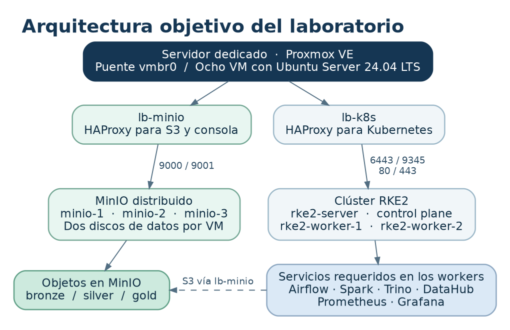

# Informe del Momento 1

## Pregunta de ingeniería

Una empresa comercial recibe ventas de sus sucursales, movimientos de inventario y un catálogo de productos mantenido por separado. Para explicar una diferencia entre ventas y existencias necesita conservar los archivos de origen y reconstruir sus transformaciones. El proyecto propone guardar los objetos en MinIO, procesarlos por capas y publicar tablas consultables. El primer momento evalúa la infraestructura que sostiene ese flujo.

El objetivo del corte es determinar qué partes de la base operan en un entorno remoto, qué archivos permiten reproducir las restantes y qué evidencia falta para demostrar la topología del profesor. El peso académico del momento es del **30 %**. El porcentaje lo establece la guía y la calificación corresponde al docente.

## Arquitectura y dependencias

En el diseño del profesor, un servidor con Proxmox VE aloja dos grupos de máquinas Ubuntu Server 24.04 LTS. Un balanceador dirige las solicitudes S3 y de consola hacia tres nodos MinIO. El segundo dirige las conexiones de RKE2 hacia el servidor de control y las peticiones de aplicaciones hacia sus workers. El inventario asigna dos unidades de datos a cada nodo MinIO.

El almacenamiento y el cómputo tienen ciclos de vida independientes. Un pod puede volver a crearse en otro worker y solicitar el mismo objeto a través de S3. La disponibilidad completa exige conservar también los componentes compartidos, entre ellos el servidor físico, los balanceadores y el único control plane. La distribución sugerida de los seis servicios analíticos en los workers aparece en la página 2 de la guía.

## Cómo se verificó este avance

Se leyó la guía completa de ocho páginas, incluidas las figuras de arquitectura y flujo. Cada fila de `REQUIREMENTS_MATRIX.csv` asocia un requisito a su página de origen, método, criterio, estado y evidencia. Para el Momento 1 se probaron en el entorno remoto los componentes que admitían ejecución y se prepararon controles de aceptación para la instalación en Proxmox.

| Elemento | Evidencia que debe examinar el evaluador |
|------------------|---------------------------------------------------|
| Proxmox y Ubuntu | Plan de ocho VM, inventario, plantillas de inicialización y registro de pruebas de aprovisionamiento. Las VM encendidas deben comprobarse en el hipervisor. |
| MinIO y su balanceador | Tres contenedores, seis volúmenes de datos y HAProxy verificados. P3 conservó lectura y escritura con cuatro discos. P4 recuperó los seis discos y verificó los objetos desde cada nodo. [Acta](../../evidence/moment-01/minio/validacion/result.json) |
| RKE2 y su balanceador | Configuración, validación de manifiestos y comprobaciones de los puertos. El registro identifica los procesos que participaron. |
| Acceso a la entrega | Informe en PDF, fuentes editables, portal estático y descargas. El índice vincula cada evidencia con el requisito correspondiente. |

## Resultados técnicos

El inventario divide las ocho VM en dos balanceadores, tres nodos de almacenamiento, un control plane y dos workers. La red propuesta es `10.42.10.0/24`. El plan puede inspeccionarse antes de reservar recursos o registrar una VM en el hipervisor. El escenario completo requiere comprobar 56 trayectos dirigidos entre pares de máquinas distintas.

Los resultados de almacenamiento y Kubernetes se conservan en los directorios de evidencia del Momento 1. Para interpretar cada salida hay que identificar si corresponde al host efímero, a un servicio en contenedor, a un proceso aislado o al despliegue objetivo en VM. Un HTTP 200 del balanceador acredita la operación consultada. La prueba de lectura de un objeto requiere además descargar sus bytes y comparar el SHA-256.

## Revisión para la siguiente demostración

| Entrega de la guía | Condición que permite aceptarla |
|----------------------|--------------------------------------------------|
| Infraestructura base (págs. 3–4) | Acceso a Proxmox y a las ocho VM, asignaciones conformes al inventario y comunicación dirigida entre ellas. |
| MinIO (págs. 3–4) | Panel accesible, tres nodos comunicados, creación de usuario, política y bucket, carga y descarga por el balanceador. |
| Kubernetes (págs. 3–4) | Un servidor y dos workers unidos, todos en estado Ready y con acceso a través del balanceador. |
| Flujo y gobierno (págs. 4–6) | Ejecución de Airflow y Spark, consulta por Trino y catálogo con linaje en DataHub. Corresponde al Momento 2. |
| Monitoreo y pruebas (págs. 6–8) | Métricas, dashboards y seis pruebas con resultados observados. Corresponde al Momento 3. |

Para completar la demostración del primer momento se necesita un host remoto autorizado con Proxmox, almacenamiento y recursos para las ocho VM. La verificación a escala completa debe relacionar identidad, dirección y rol de cada máquina con las salidas del inventario y repetir la transferencia de un objeto usando el usuario de servicio.

## Referencias y anexos

- Guía del profesor, *Diseño e Implementación de una Plataforma Empresarial para un Lago de Datos Distribuido*, págs. 1–8. El archivo original se conserva en la raíz del proyecto.
- `docs/moment-01/entrega/` reúne el documento de arquitectura, los manuales y la guía de sustentación.
- `EVIDENCE_INDEX.md` identifica las ejecuciones disponibles. `PROJECT_STATE.md` conserva decisiones operativas y actividades pendientes.
- `infrastructure/proxmox/inventory.json` contiene las asignaciones de las VM. `REQUIREMENTS_MATRIX.csv` conserva la trazabilidad de los tres momentos.
